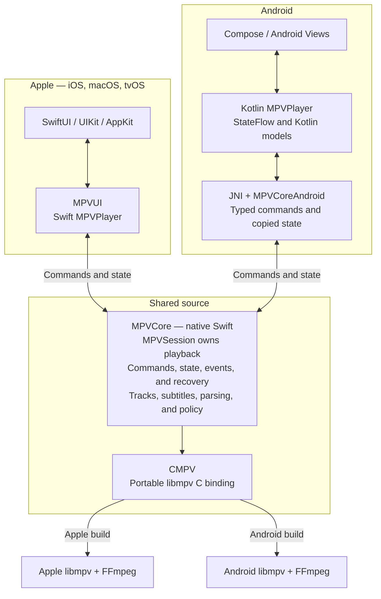
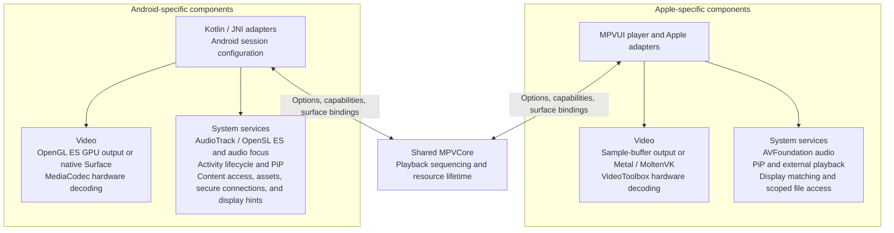
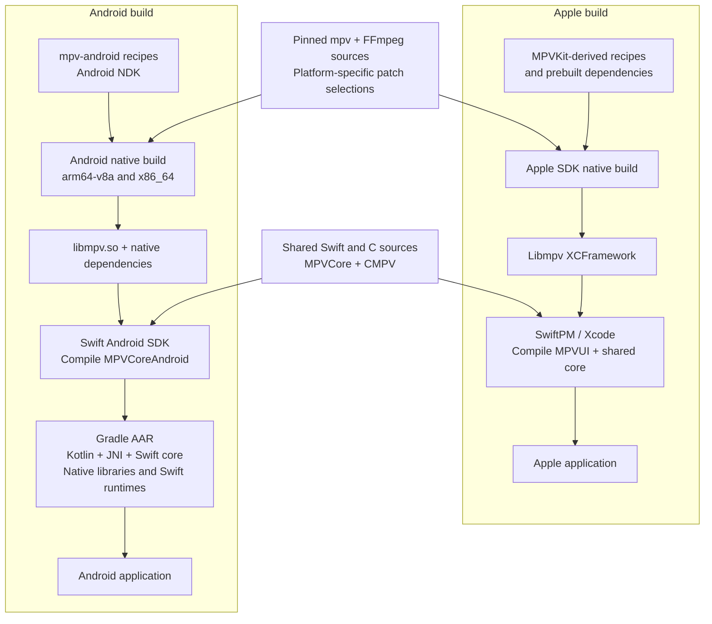

# MPVUI architecture

MPVUI compiles the same Swift playback core for Apple platforms and Android. Each playback session owns its libmpv handle. Platform APIs and observers access that session without creating another playback engine. Each platform handles its own UI, rendering, and operating-system services.

## Runtime ownership

Platform APIs send commands to the shared session, the session returns copied state, errors, logs, and subtitle results. Apple and Android each link their own native library build.

`MPVSession` orders commands, event processing, source changes, queries, and shutdown on one serial queue. It copies native event data before libmpv can reuse the memory. Shutdown rejects late callbacks and completes or cancels pending work before releasing resources.

| Component                                                            | Responsibility                                                                                              |
| -------------------------------------------------------------------- | ----------------------------------------------------------------------------------------------------------- |
| [`MPVCore`](../Sources/MPVCore/)                                     | Shared models, session ownership, playback state, parsing, subtitle queries, and command and output policy. |
| [`CMPV`](../Sources/CMPV/)                                           | Portable C declarations connecting Swift to the platform's libmpv build.                                    |
| [`MPVUI`](../Sources/Player/MPVPlayer.swift)                         | Observable Apple player, views, configuration, and system integration.                                      |
| [`MPVCoreAndroid`](../Sources/MPVCoreAndroid/)                       | Android session configuration and versioned C interface with retained handles and owned buffers.            |
| [`JNI bridge`](../Android/mpvui/src/main/cpp/mpvui.cpp)              | Java interaction, typed transport, retained Android surfaces, and content and asset access.                 |
| [`Kotlin player`](../Android/mpvui/src/main/java/mpvui/MPVPlayer.kt) | Android services, Kotlin models, command delegation, and state delivery through coroutines.                 |

`MPVCore` depends on portable Foundation and Dispatch APIs and `CMPV`. Platform frameworks and UI libraries live in the adapters. Kotlin models expose shared state through the Kotlin API.

## Platform services

Platform adapters manage rendering, audio, file access, and system integration. They provide the core with native options, capability information, source access, and opaque surface bindings.

Adapters retain surfaces until native rendering has detached and its work has finished. The core orders surface changes through opaque handles.

Apple keeps the configured video output for the player's lifetime. Android allows fallback only when the app requests automatic output. Unsupported explicit output choices produce an error.

The shared core records high dynamic range (HDR) and Dolby Vision source metadata separately from decoder and output evidence. Source tags and display capabilities alone don't confirm the active presentation path. See [Rendering](../Build/RENDERING.md) for platform output behavior.

## Build and distribution

Both platforms use the same pinned mpv and FFmpeg revisions. Each has its own patches, dependencies, toolchain, and binaries. The [package manifest](../Package.swift) excludes Apple binary targets, Objective-C code, and Apple framework links from Android builds.

The Apple build uses recipes adapted from [MPVKit](https://github.com/mpvkit/MPVKit) and pinned prebuilt dependencies from that project. This repository's build tooling produces the `Libmpv` XCFramework consumed by SwiftPM.

Android builds libmpv with pinned `mpv-android` recipes and the Android Native Development Kit (NDK). The Swift Android SDK compiles the shared core to a native library. Gradle bundles Kotlin, the Java Native Interface (JNI) bridge, the core, native dependencies, and Swift runtimes into the archive.

[Inputs.lock.json](../Build/Inputs.lock.json) pins build inputs. Input fingerprints detect stale outputs, and Android packaging verifies library and runtime compatibility for both supported architectures.
